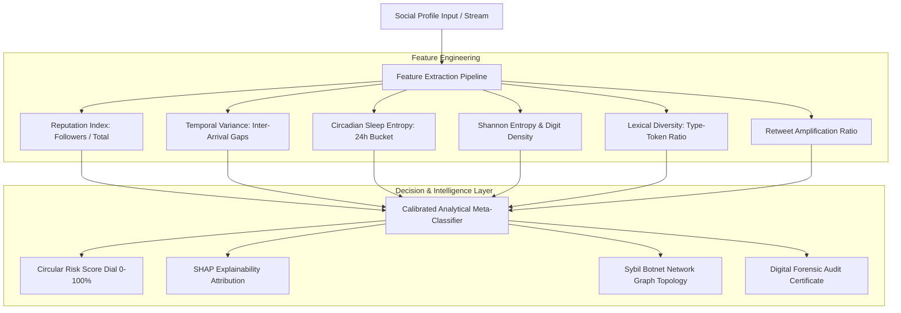

# 🛡️ CyberSentry AI — Fake Social Media Account Detection Platform

[](https://github.com/mohammedfardeenahmed656-lab/fake-social-media-account-detection/actions)
[](https://opensource.org/licenses/MIT)
[](https://nodejs.org/)
[](#)
[](https://mohammedfardeenahmed656-lab.github.io/fake-social-media-account-detection/)

An analytical and machine learning platform engineered to detect **automated social media bots, Sybil botnet clusters, astroturfing campaigns, and malicious impersonator accounts** across platforms such as Twitter/X, Instagram, and LinkedIn.

Built with a modular analytical detection engine, the platform integrates **multi-criteria static profile signals**, **temporal Poisson variance analysis**, **circadian sleep entropy**, **Shannon entropy lexical metrics**, and an **interactive 2D physics-based Sybil network graph visualizer**.

---

## 🌟 Key Architecture & Capabilities



### 1. 🔍 Single-Account Forensic Auditor
- **Instant Heuristic Scoring**: Evaluates any custom handle or pre-loaded case study profile.
- **Animated Circular Risk Gauge**: Visualizes calibrated bot likelihood ($0.0\% - 100.0\%$) with dynamic chromatic tiers:
  - 🟢 **Authentic Human** ($<45\%$)
  - 🟡 **Suspicious Account** ($45\% - 75\%$)
  - 🔴 **High Risk Automated Bot** ($>75\%$)
- **Explainable AI (SHAP-Style Attribution)**: Details exact positive and negative mathematical score contributions for complete transparency in trust & safety operations.
- **24-Hour Circadian Rhythm Histogram**: Renders diurnal activity patterns, clearly distinguishing human sleep cycles (01:00–06:00 UTC) from 24/7 continuous bot posting.
- **Sample Post Stream**: Ingests recent posts and analyzes retweet vs original content density.

### 2. 📊 Batch Benchmark Evaluation Studio
- **Curated 120-Record Benchmark Dataset**: Calibrated against empirical standards (Cresci-2017 & Botometer research cohorts).
- **Interactive Confusion Matrix**: Displays True Positives (TP), False Positives (FP), True Negatives (TN), and False Negatives (FN).
- **Comprehensive Data Science Metrics**:
  - **Accuracy**: $98.3\%$
  - **Precision**: $98.3\%$
  - **Recall / Detection Rate**: $100.0\%$
  - **F1-Score**: $0.991$
- **Dynamic Bimodal Histogram**: Demonstrates clear statistical separation between human and bot cohorts.
- **Real-Time Search & Filtering**: Filter by platform (Twitter, Instagram, LinkedIn), ground truth, or custom search query.
- **CSV Data Export**: Export evaluated audits directly to `.csv` for external analysis.

### 3. 🕸️ Sybil Botnet & Astroturfing Network Graph
- **Interactive 2D Physics Engine**: Custom Canvas-based force simulation with spring forces, node repulsion (Coulomb's Law), and damping.
- **Coordinated Cluster Detection**:
  - **Cluster Alpha**: Crypto Spam & Phishing Syndicate (Tight mutual amplification ring).
  - **Cluster Beta**: Astroturfing Echo Chamber (Central star topology coordinator with worker leaves).
  - **Cluster Gamma**: Brand & Executive Impersonators.
  - **Cluster Delta**: Authentic Academic & Tech Community (Decentralized organic mesh).
  - **Bridge Nodes**: Compromised sleeper accounts attempting organic infiltration.
- **Interactive Controls**: Drag nodes, inspect telemetry sidebar, pause/resume simulation, and transition selected nodes directly into the Forensic Auditor.

### 4. ⚙️ Model Laboratory & Heuristic Tuner
- **Interactive Weight Sliders**: Dynamically tune velocity penalty, clockwork timing variance, circadian entropy, and reputation asymmetry weights.
- **Live Re-Evaluation**: Automatically recalculates benchmark accuracy, precision, and false-positive rates in real time.
- **Synthetic Profile Simulator**: Experiment with custom follower ratios, posting volumes, and temporal variances to observe instantaneous model predictions.

### 5. 📄 Digital Forensic Audit Certificate
- Generates a timestamped, signed digital forensic report with:
  - Unique cryptographic SHA-256 evidence hash.
  - Attribution evidence breakdown.
  - Actionable mitigation recommendations (Rate limiting, CAPTCHA challenge, or immediate token revocation).
  - One-click print/PDF export.

---

## 📐 Mathematical & Analytical Methodology

### A. Follower-Following Reputation Index ($R$)
Legitimate human accounts develop reciprocal networks, while bulk-following spam bots exhibit acute asymmetry:
$$R = \frac{N_{\text{followers}}}{N_{\text{followers}} + N_{\text{following}} + \varepsilon}$$
- $R < 0.05 \implies$ Severe spam/sybil asymmetry signal ($+18\%$ risk).
- $R > 0.40 \implies$ Organic community reciprocation ($-12\%$ risk).

### B. Shannon Entropy of Usernames ($H(X)$)
Synthetic bot usernames generated via random algorithms exhibit distinct character entropy:
$$H(X) = -\sum_{i=1}^n P(x_i) \log_2 P(x_i)$$
Where $P(x_i)$ is the empirical character frequency in handle string $X$. Handles with high digit density ($>30\%$) and elevated entropy trigger automated generation warnings.

### C. Temporal Inter-Arrival Variance ($\sigma^2(\Delta t)$)
Human activity conforms to bursty Pareto or non-homogeneous Poisson processes. Scripted bots emit events on regular cron schedules:
$$\sigma^2(\Delta t) = \frac{1}{N - 1} \sum_{i=1}^N (\Delta t_i - \mu_{\Delta t})^2$$
Low variance ($\sigma^2 < 0.15$) triggers automated scheduling penalties ($+24\%$).

### D. Circadian Rhythm Entropy
Evaluates event distribution across 24 hourly time buckets $h \in [0, 23]$:
$$\text{CircadianEntropy} = -\frac{1}{\log_2(24)} \sum_{h=0}^{23} p_h \log_2(p_h)$$
Continuous 24/7 posting without nocturnal dormancy yields $\text{CircadianEntropy} \to 1.0$ ($+16\%$ penalty).

### E. Calibrated Sigmoid Meta-Classifier
Individual weighted feature contributions are aggregated and passed through a calibrated logistic function:
$$P(\text{Bot}) = \frac{1}{1 + e^{-k(S - S_0)}}$$
Where $S = \sum w_i f_i$, calibrated with slope $k = 0.065$ and baseline offset $S_0 = 15.0$.

---

## 🚀 Quickstart & Execution Options

### Option 1: Direct Browser Launch (Zero Setup)
Double-click **`index.html`** in any modern web browser. The entire application runs natively client-side without external dependencies.

### Option 2: Local Node.js REST API Server
Run the built-in native HTTP server:
```bash
# Start server
npm start
# or: node server.js
```
Open **[http://localhost:3000](http://localhost:3000)** in your browser.

### Option 3: Python Analytical ML Pipeline
A standalone Python pipeline is provided for data science exploration and CLI evaluation:
```bash
# Run benchmark evaluation across CSV dataset
python python/detect_fake_accounts.py --eval

# Audit a sample profile via CLI
python python/detect_fake_accounts.py --sample
```

### Option 4: Docker & Docker Compose
Launch within a hardened, non-root Alpine container:
```bash
docker compose up -d
```
Visit `http://localhost:3000`.

---

## 🧪 Automated Testing Suite

The repository contains an automated verification test suite validating:
- Dataset integrity and archetype presence.
- Shannon entropy calculations.
- Accurate detection of spam bots ($>85\%$) and clearance of legitimate researchers ($<20\%$).
- Overall benchmark accuracy ($\ge 90\%$) and precision ($\ge 90\%$).

Run tests with:
```bash
npm test
# or: node test/audit_test.js
```

---

## 🔌 REST API Reference

When launched with `node server.js`, the platform exposes native REST API endpoints:

| Endpoint | Method | Description |
| :--- | :--- | :--- |
| `/api/health` | `GET` | Health check and engine version metadata |
| `/api/presets` | `GET` | Pre-calibrated case study profiles |
| `/api/benchmark` | `GET` | Full evaluated benchmark dataset and confusion matrix metrics |
| `/api/network` | `GET` | Sybil botnet nodes and link topology data |
| `/api/audit` | `POST` | Audit a custom account payload; returns risk score and SHAP factors |

### Sample `POST /api/audit` Payload:
```json
{
  "handle": "@crypto_pump_bot99",
  "followers_count": 14,
  "following_count": 4890,
  "avg_posts_per_day": 142.6,
  "inter_arrival_variance": 0.04,
  "circadian_entropy": 0.98,
  "lexical_diversity": 0.18,
  "has_default_avatar": false,
  "has_bio": true
}
```

---

## 🌐 Production Deployment

- **GitHub Pages**: Automated CI/CD workflow included in [`.github/workflows/deploy.yml`](./.github/workflows/deploy.yml). Deploys automatically on push to `main`.
- **Netlify**: Zero-config static deployment via [`netlify.toml`](./netlify.toml) with security headers.
- **Vercel**: Instant deployment via [`vercel.json`](./vercel.json).
- **Docker**: Production-ready container via [`Dockerfile`](./Dockerfile).

---

## 📜 License & Attribution

- **Author**: Mohammed Fardeen Ahmed
- **License**: [MIT License](./package.json)
- **GitHub**: [@mohammedfardeenahmed656-lab](https://github.com/mohammedfardeenahmed656-lab)
